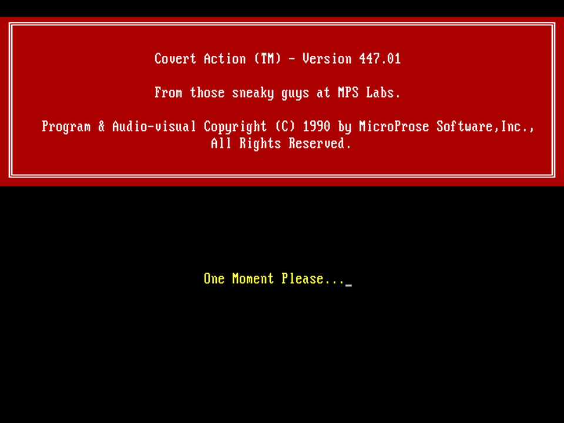
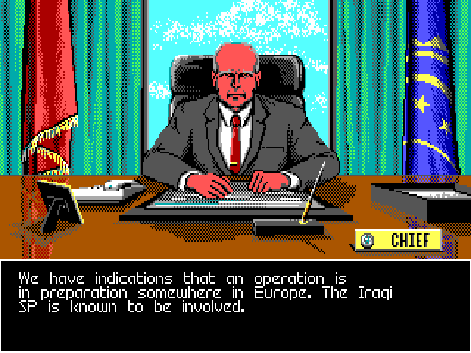
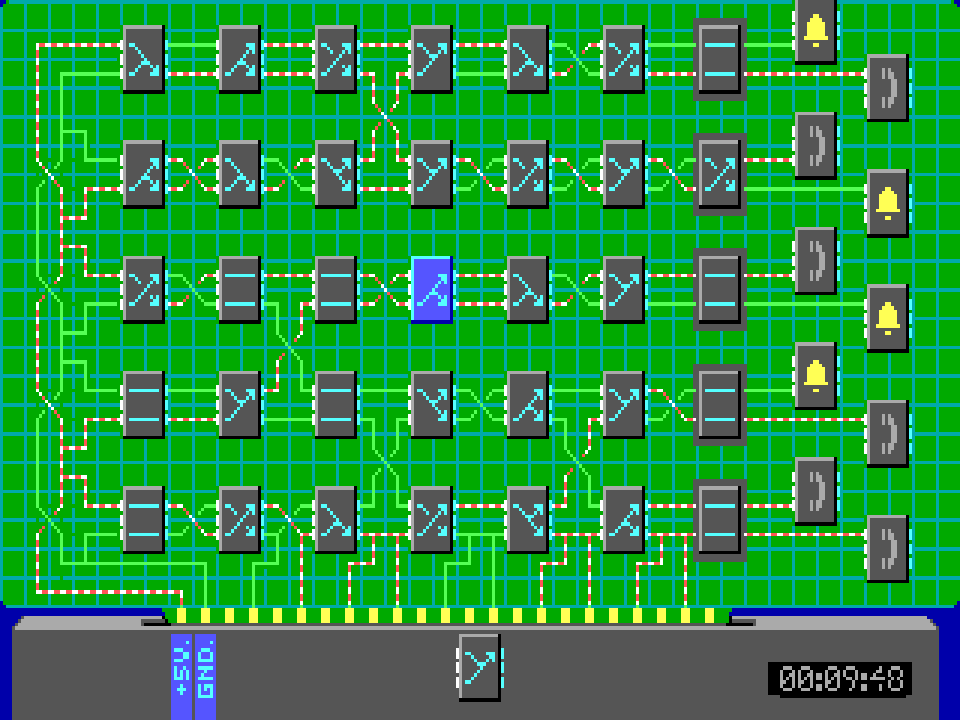
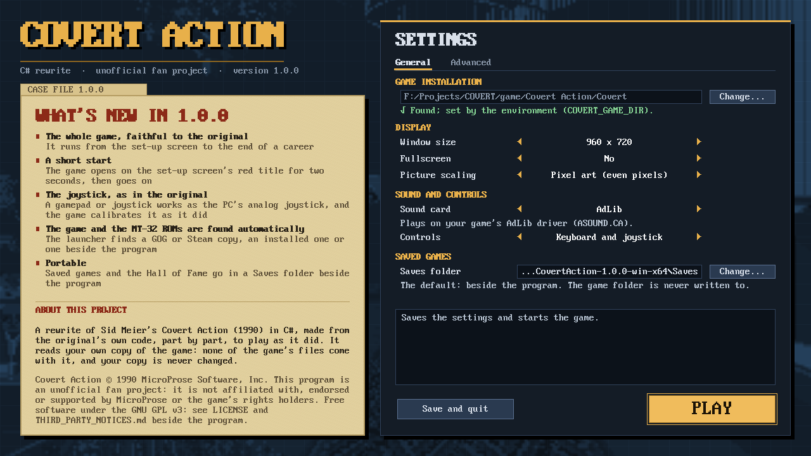

# Covert Action Enhanced

A rewrite of *Sid Meier's Covert Action* (MicroProse, 1990, DOS) as a native Windows program in C#, made from the
original's own code, part by part, so that it plays as the original did. You need your own copy of the game: none of its
files come with this project, and your copy is never changed.

**Status: version 1.0, the faithful version.** The whole game runs, from the set-up screen to the end of a career:
the menus, the briefings, the campaign, the building raids, the electronics workbench, the car chase, the cryptography
workstation, saving and loading, the joystick and all four of the original's sound cards. 1.0 has nothing the original
does not have, and stays the reference; options beyond the original come after it. Its limits are in
[Known limits of 1.0](#known-limits-of-10); what 1.0 had to meet is in [release 1.0](csharp/docs/RELEASE-1.0.md).

<table>
<tr>
<td></td>
<td></td>
</tr>
<tr>
<td align="center">The start: the set-up screen's title</td>
<td align="center">The title</td>
</tr>
<tr>
<td></td>
<td></td>
</tr>
<tr>
<td align="center">The Chief's briefing</td>
<td align="center">Equipment for a building raid</td>
</tr>
<tr>
<td></td>
<td></td>
</tr>
<tr>
<td align="center">The car chase</td>
<td align="center">The electronics workbench</td>
</tr>
<tr>
<td colspan="2" align="center"></td>
</tr>
<tr>
<td colspan="2" align="center">The cryptography workstation</td>
</tr>
</table>

The settings launcher:



Screenshots of the rewrite running on the author's copy of the game.

## Playing

1. Unpack a release anywhere (not into the game's own folder).
2. Start `CovertAction.exe`. Your copy of the game is found by itself when it is a GOG or Steam copy, an installed
   one, or one beside the program; if it is not found, the launcher opens: choose your game folder with **Change…**,
   then **Play**.
3. The game starts with the title of the original's set-up screen for two seconds, then goes on. Its questions are
   not asked: the picture is always the MCGA's, and the sound card (AdLib by default) and the controls (keyboard and
   joystick by default) are settings of the launcher.

`CovertAction Launcher.exe` (or Shift held while the game starts) opens the settings: the game folder, the window
size, fullscreen, the picture's scaling, the sound card (with a sound test), the controls, the saved games' folder, the MT-32 ROM
folder and the keyboard's repeat. They are kept in `covertaction.settings.json`; see
[the settings](csharp/docs/SETTINGS.md).

* **Sound:** PC speaker, AdLib, Tandy and Roland MT-32. The MT-32 is Munt's emulation and needs your own MT-32 (or
  CM-32L) ROM files: they are looked for in `MT32_ROMS` beside the program, near the game and in DOSBox's folders, or
  you choose their folder in the launcher. Without them the AdLib plays instead.
* **Portable:** nothing is installed. Saved games and the Hall of Fame go to `Saves` beside the program (or a folder
  you choose; `%LOCALAPPDATA%\CovertAction\Saves` when the program's folder cannot be written to), never into the
  game's folder. The saves you made with the original load as they are.
* **Controls** are the original's. In a building raid, walk with the numeric keypad (the game turns Num Lock on, as the
  original did); the grey arrow keys lunge. A joystick or gamepad works as the original's joystick: with the
  launcher's controls "Keyboard and joystick" (the default) the game calibrates it at the start (or press Alt-J in the
  game) with the stick at rest; "Keyboard only" leaves it out. The left stick
  (or the directional pad) is the stick, the bottom face button the first button, the right one the second.

## How it is made faithful

The rewrite is checked against the original program at every level, not by eye:

1. **The original's functions, reconstructed and checked.** Every function of the original's eight programs (COVERT,
   INTRO, FINAL, GAME, TAC, BUG, CHASE, CODE) was reconstructed as readable C, and each reconstruction was checked
   against the original: it compiles with Microsoft C 5.1 to the original's exact bytes. That reconstruction is the
   specification; it is the original's code in another form, so it is kept privately and not published here. Many names are MicroProse's own, recovered from the Amiga release's symbol table
   ([Amiga](docs/amiga.md)).
2. **A C# rewrite of that specification.** One program instead of eight, plain readable C#, no emulator
   ([architecture](csharp/ARCHITECTURE.md)). Every member names the original routine it comes from
   (`// orig: <MODULE> <address>`), and a source map checks that every one of the original's functions is either
   rewritten or set aside for a stated reason.
3. **Function by function against the original.** An oracle runs each original function in an emulator and records
   what it does; the C# must do the same (more than 700 tests of recorded cases), and deliberate bugs planted in the C# must be
   caught.
4. **Whole sessions against the original.** The same keys are played through the original program, run whole with its
   own drivers, and through the rewrite, and the two are compared at every checkpoint: the picture, the palette, the
   sound driver's output, the data handed from part to part and the files written. More than 100 recorded sessions cover
   every part of the game and the launcher's whole flow; all agree apart from registered differences
   ([session proof](csharp/docs/SESSION-PROOF.md)).

Where the rewrite does differ, the difference is written down: [divergences](csharp/docs/faithfulness/DIVERGENCES.md)
(what the rewrite does differently, and why), [the original's bugs](docs/original-bugs.md) (kept, unless they damage
data), and [cut content](docs/cut-content.md) found in the original's code and data.

## Known limits of 1.0

* Only the MCGA picture. In this game the EGA, VGA and Tandy choices show the same 16 colours as the MCGA; the CGA's
  four-colour picture is not offered ([D-600](csharp/docs/faithfulness/DIVERGENCES-INTRO.md)).
* Player options beyond the original (the mouse, arrow keys that walk in raids, music and effects on different sound
  cards) come after 1.0, which stays faithful to the original.
* The joystick is not yet tried with a real controller; how a real stick's position turns into the game's readings is
  a model ([U-12](csharp/docs/faithfulness/UNCERTAIN.md)).
* A damaged save (cut short or the wrong size) is listed as empty instead of loading into a broken campaign
  ([D-105](csharp/docs/faithfulness/DIVERGENCES-FINAL.md)).
* Windows only for now.

## Building from source

Requirements: the .NET 10 SDK and your own copy of the game.

```powershell
cd csharp
dotnet build -c Release
dotnet run -c Release --project src/CovertAction.Host.Sdl -- "<your game folder>"
```

Tests: `dotnet test` in `csharp`. With `COVERT_GAME_DIR` set to your game folder the tests that need the game's files
run too; the oracle and session tests also need the recordings made from your copy (`tools/oracle`,
`tools/session`), which are never committed. A release folder and zip: `python -B csharp/tools/publish_release.py`.
How to work on the code: [contributing](csharp/CONTRIBUTING.md).

## What is here

| Location | Purpose |
|---|---|
| [`csharp/`](csharp) | The C# rewrite: the game, its hosts (SDL window, headless), the launcher, tests and docs |
| [`symbols/`](symbols), [`docs/data-model/`](docs/data-model) | Names and the data model of the original |
| [`tools/`](tools) | The function oracle (`tools/oracle`) and the session proof (`tools/session`) that record the original's behaviour, and the programs they share |
| [`docs/`](docs) | Research notes on the original: its bugs, its cut content, its data |
| `build/` | Generated material, local and never committed |

The game's files, anything extracted from them and generated translations of their code stay out of version control.

## Licence

Free software under the GNU General Public License, version 3 ([LICENSE](LICENSE)). Third-party code and tools keep
their own licences and notices ([THIRD_PARTY_NOTICES.md](THIRD_PARTY_NOTICES.md)).

*Covert Action* © 1990 MicroProse Software, Inc. This is an unofficial fan project, not affiliated with, endorsed or
supported by MicroProse or the game's rights holders.
