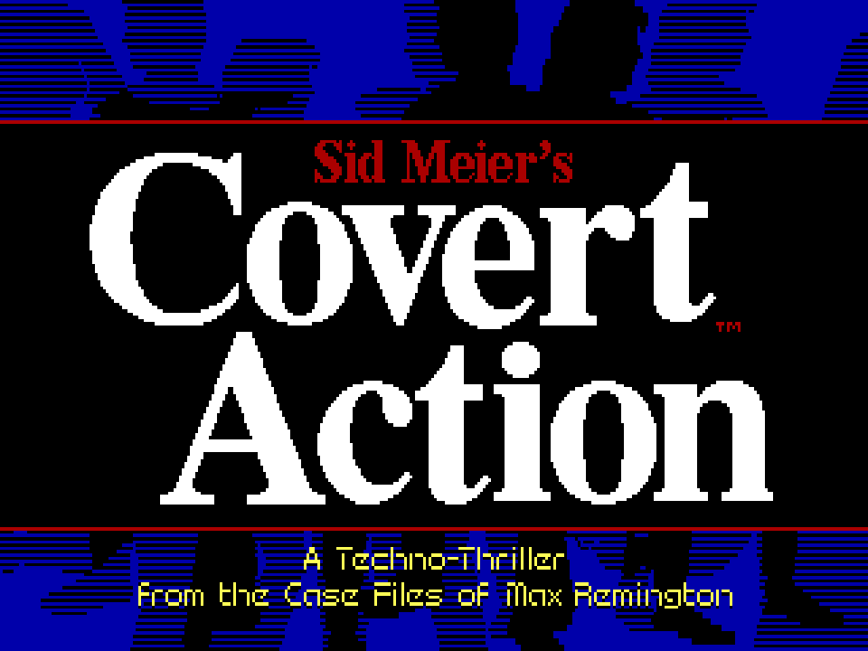
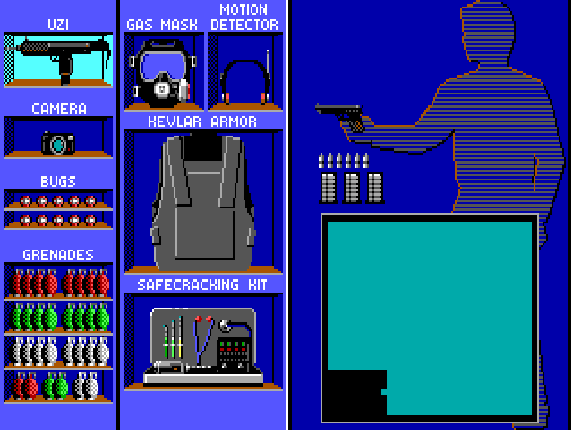
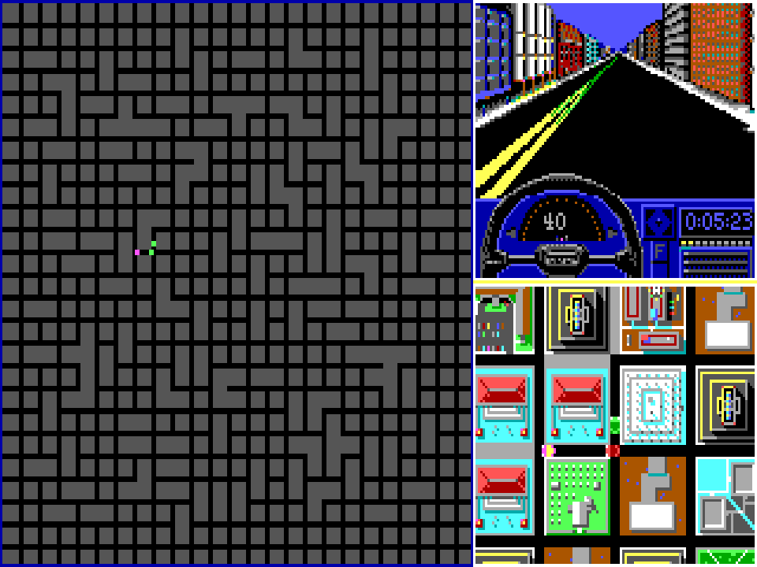
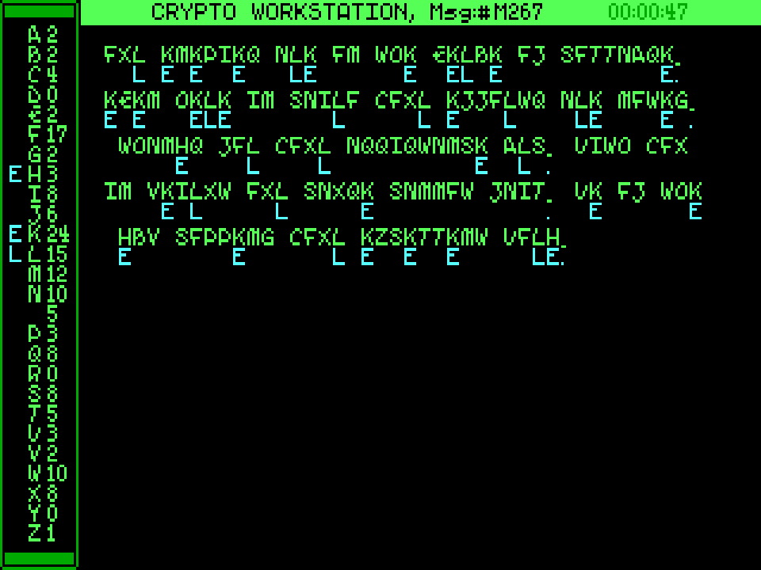
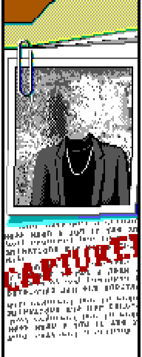
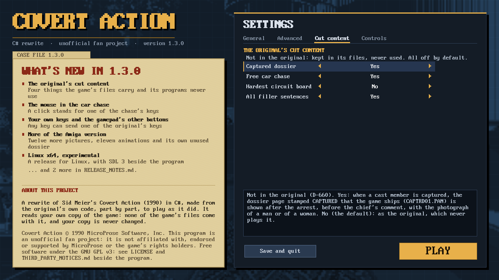

# Covert Action Enhanced

A rewrite of *Sid Meier's Covert Action* (MicroProse, 1990, DOS) as a native Windows program in C# (and, experimental, a Linux one), made from the
original's own code, part by part, so that it plays as the original did. You need your own copy of the game: none of its
files come with this project, and your copy is never changed.

**Status: version 1.3.** The whole game runs, from the set-up screen to the end of a career: the menus, the
briefings, the campaign, the building raids, the electronics workbench, the car chase, the cryptography workstation,
saving and loading, the joystick and all four of the original's sound cards. Version 1.0 is the faithful version and
stays the reference (its `release/1.0` branch and the tag `v1.0`; what it had to meet is in
[release 1.0](csharp/docs/RELEASE-1.0.md)). Versions 1.1 to 1.3 add [player options](#player-options), all off by default: with them off,
the game plays as 1.0 and the original. Its limits are in [Known limits](#known-limits).

<table>
<tr>
<td></td>
<td></td>
</tr>
<tr>
<td align="center">The start: the set-up screen's title</td>
<td align="center">The title</td>
</tr>
<tr>
<td></td>
<td></td>
</tr>
<tr>
<td align="center">The Chief's briefing</td>
<td align="center">Equipment for a building raid</td>
</tr>
<tr>
<td></td>
<td></td>
</tr>
<tr>
<td align="center">The car chase</td>
<td align="center">The electronics workbench</td>
</tr>
<tr>
<td colspan="2" align="center"></td>
</tr>
<tr>
<td colspan="2" align="center">The cryptography workstation</td>
</tr>
</table>

The settings launcher:


Screenshots of the rewrite running on the author's copy of the game.

## Playing

1. Unpack a release anywhere (not into the game's own folder).
2. Start `CovertAction.exe`. Your copy of the game is found by itself when it is a GOG or Steam copy, an installed
   one, or one beside the program; if it is not found, the launcher opens: choose your game folder with **Change…**,
   then **Play**.
3. The game starts with the title of the original's set-up screen for two seconds, then goes on. Its questions are
   not asked: the picture is always the MCGA's, and the sound card (AdLib by default) and the controls (keyboard and
   joystick by default) are settings of the launcher.

`CovertAction Launcher.exe` (or Shift held while the game starts) opens the settings: the game folder, the window
size, fullscreen, the picture's scaling, the sound card (with a sound test), the controls, the saved games' folder, the MT-32 ROM
folder and, on its Advanced, Cut content and Controls tabs, the keyboard's repeat and the player options. They are kept in `covertaction.settings.json`; see
[the settings](csharp/docs/SETTINGS.md).

* **Sound:** PC speaker, AdLib, Tandy and Roland MT-32. The MT-32 is Munt's emulation and needs your own MT-32 (or
  CM-32L) ROM files: they are looked for in `MT32_ROMS` beside the program, near the game and in DOSBox's folders, or
  you choose their folder in the launcher. Without them the AdLib plays instead.
* **Portable:** nothing is installed. Saved games and the Hall of Fame go to `Saves` beside the program (or a folder
  you choose; `%LOCALAPPDATA%\CovertAction\Saves` when the program's folder cannot be written to), never into the
  game's folder. The saves you made with the original load as they are.
* **Controls** are the original's. In a building raid, walk with the numeric keypad (the game turns Num Lock on, as the
  original did); the grey arrow keys lunge. A joystick or gamepad works as the original's joystick: with the
  launcher's controls "Keyboard and joystick" (the default) the game calibrates it at the start (or press Alt-J in the
  game) with the stick at rest; "Keyboard only" leaves it out. The left stick
  (or the directional pad) is the stick, the bottom face button the first button, the right one the second.

## Player options

Not in the original, each off by default, on the launcher's Advanced, Cut content and Controls tabs ([the settings](csharp/docs/SETTINGS.md)):

* **The mouse** ([D-630 to D-636](csharp/docs/faithfulness/DIVERGENCES.md)): in the menus, lists and on the flight map,
  pointing at a choice highlights it, a left click takes it, a right click is Esc. At the electronics workbench it moves
  the cursor to a chip's slot and a click swaps the chip; at the cryptography workstation a click on a letter of the
  message selects it (the replacement is typed); in a building raid the agent walks towards the pointer while the left
  button is held and a right click is the fire button. In the car chase, with its own setting ([D-670](csharp/docs/faithfulness/DIVERGENCES.md)),
  a click stands for one of the chase's keys: the arrow of that side of the car, the gears, switching cars, entering a
  place, the arrest; it gives nothing the keys do not.
* **Your own keys and the gamepad's other buttons** ([D-671, D-672](csharp/docs/faithfulness/DIVERGENCES.md), on the
  Controls tab): any key of your keyboard can send one of the original's keys, and the gamepad's shoulders, triggers,
  Start, Back and stick clicks can each send one; the original keys keep working.
* **Arrow keys that walk in a building raid** ([D-610](csharp/docs/faithfulness/DIVERGENCES-INTRO.md)): the grey arrow keys
  walk the agent as the keypad does, and Shift with an arrow lunges.
* **Music and sound effects on different sound cards** ([D-620](csharp/docs/faithfulness/DIVERGENCES-INTRO.md)), for example
  the music on the MT-32 and the effects on the AdLib.
* **The Amiga version's music** ([D-640](csharp/docs/faithfulness/DIVERGENCES.md), [how it plays](csharp/docs/AMIGA-MUSIC.md)):
  the tunes of the Amiga version, played from the Amiga music files you own (none come with the program), in place of the
  sound card's music while the effects stay on the card.
* **The Amiga version's sound effects** ([D-641](csharp/docs/faithfulness/DIVERGENCES.md), [the table](csharp/docs/AMIGA-EFFECTS.md)):
  the shots, doors, camera, aeroplane, chips and the rest of the Amiga version's effects, played from the Amiga sound
  files you own where the Amiga game has the same sound, the sound card's effects elsewhere (or silence, if you prefer).
* **The Amiga version's pictures and animations** ([D-642, D-681 to D-684](csharp/docs/faithfulness/DIVERGENCES.md), [the list](csharp/docs/AMIGA-PICTURES.md)):
  the faces, icons, maps, the hotel and most city pictures of the Amiga version, in its colours, and eleven of its
  animations, read from the Amiga files you own; a picture or animation the Amiga made in another layout stays the PC's.
  With the captured dossier on as well, the Amiga's own unused dossier plays.
* **Fix the original's bugs** ([D-650](csharp/docs/faithfulness/DIVERGENCES.md), [the register](docs/original-bugs.md)): the
  original's bugs that do not change the story are fixed: a clue that read "is information requires security clearance",
  the key that skips an animation staying in the keyboard buffer, the chief's comment after every capture being the
  first one's, the Delete key of the name field taking out two characters, a car chase that stops when you press F2 with
  a building not yet known, a desk drawn over a wall, "Stasi" not found in the file room, an electronics board that cannot be
  won, the pause in walking at the fast speed of a raid and a missing Hall of Fame file that kept scores from being saved.
  A second option, **Campaign-logic bugs**, is for the bugs that change the story: events that never
  happened (the "blueprints missing" bulletin, two receive events), the "prevented crime" ending of one crime, extra
  doors in big buildings, cast members never seen leaving a city, duplicate faces, the training ratings, the apartment
  scene, a career record that overwrites a case, the hours charged after code-breaking, a new case that could hang
  while it was laid out, the Mastermind's meeting of one crime and the skills of an agent made after a practice mission.
  With both off the game is the original, bug for bug.
* **The original's cut content** ([the page](docs/cut-content-options.md), [D-660 to D-663](csharp/docs/faithfulness/DIVERGENCES.md),
  on the launcher's Cut content tab): four things the game's own files carry and its programs never use. **Captured
  dossier**: the animation of a dossier page stamped CAPTURED, with a man's or a woman's photograph, plays when a cast
  member is captured. **Free car chase**: a fifth line, "Free Chase", in the practice menu, a chase on a random map with
  the places labelled Loc1 to Loc15. **Hardest circuit board**: the electronics board's fourth difficulty, for the hardest
  level with an agent of the lowest electronics rating. **All filler sentences**: the four of the sixteen filler sentences
  of coded messages that the game never draws. The page also says which cut content is left out and why.

Two of the cut-content options and their launcher tab ([the page](docs/cut-content-options.md)):

<table>
<tr>
<td></td>
<td></td>
</tr>
<tr>
<td align="center">The captured dossier</td>
<td align="center">The free chase's map</td>
</tr>
<tr>
<td colspan="2" align="center"></td>
</tr>
<tr>
<td colspan="2" align="center">The launcher's Cut content tab</td>
</tr>
</table>

## How it is made faithful

The rewrite is checked against the original program at every level, not by eye:

1. **The original's functions, reconstructed and checked.** Every function of the original's eight programs (COVERT,
   INTRO, FINAL, GAME, TAC, BUG, CHASE, CODE) was reconstructed as readable C, and each reconstruction was checked
   against the original: it compiles with Microsoft C 5.1 to the original's exact bytes. That reconstruction is the
   specification; it is the original's code in another form, so it is kept privately and not published here. Many names are MicroProse's own, recovered from the Amiga release's symbol table
   ([Amiga](docs/amiga.md)).
2. **A C# rewrite of that specification.** One program instead of eight, plain readable C#, no emulator
   ([architecture](csharp/ARCHITECTURE.md)). Every member names the original routine it comes from
   (`// orig: <MODULE> <address>`), and a source map checks that every one of the original's functions is either
   rewritten or set aside for a stated reason.
3. **Function by function against the original.** An oracle runs each original function in an emulator and records
   what it does; the C# must do the same (more than 700 tests of recorded cases), and deliberate bugs planted in the C# must be
   caught.
4. **Whole sessions against the original.** The same keys are played through the original program, run whole with its
   own drivers, and through the rewrite, and the two are compared at every checkpoint: the picture, the palette, the
   sound driver's output, the data handed from part to part and the files written. More than 100 recorded sessions cover
   every part of the game and the launcher's whole flow; all agree apart from registered differences
   ([session proof](csharp/docs/SESSION-PROOF.md)).

Where the rewrite does differ, the difference is written down: [divergences](csharp/docs/faithfulness/DIVERGENCES.md)
(what the rewrite does differently, and why), [the original's bugs](docs/original-bugs.md) (kept, unless they damage
data), and [cut content](docs/cut-content.md) found in the original's code and data.

## Known limits

* Only the MCGA picture. In this game the EGA, VGA and Tandy choices show the same 16 colours as the MCGA; the CGA's
  four-colour picture is not offered ([D-600](csharp/docs/faithfulness/DIVERGENCES-INTRO.md)).
* In the car chase the mouse only stands for keys: there is no steering towards the pointer.
* The joystick is tried with a real gamepad (16 November 2026: the menus and a raid play as expected), but how a real
  stick's position turns into the game's readings is still a model ([U-12](csharp/docs/faithfulness/UNCERTAIN.md)).
* A damaged save (cut short or the wrong size) is listed as empty instead of loading into a broken campaign
  ([D-105](csharp/docs/faithfulness/DIVERGENCES-FINAL.md)).
* The Amiga options need the Amiga version's own files; without them the PC's music, effects and pictures play.
* The bug fixes are options, off by default: with them off the original's bugs stay, bug for bug
  ([the register](docs/original-bugs.md)).
* Windows is the tested system; the Linux x64 build is experimental (below). There is no macOS build.

## Linux (experimental)

A release for Linux x64 comes as `CovertAction-<version>-linux-x64.tar.gz` with a
`.sha256` file. Unpack it with `tar -xzf` (a zip would lose the executable bits) and start `./CovertAction`, or
`CovertAction Launcher` for the settings screen. It carries SDL 3.4.20 as `libSDL3.so.0` beside the program, built on Ubuntu
22.04 from SDL's source release (`csharp/tools/linux/build_sdl3.sh` in an `ubuntu:22.04` container), so it needs glibc 2.34 or
later (Ubuntu 22.04 and later, for example) and no SDL 3 of the system's own;
delete it to use the system's. The .NET runtime inside the program needs `libicu`, which desktop systems have (a bare
container does not: `apt install libicu70` or `libicu74`). Your own copy of the game is found beside the program, in Steam's libraries, Heroic's installed
games, the usual GOG and Lutris folders and Wine prefixes, or you choose it in the launcher; file names may be in any case.
Settings and saved games stay beside the program when its folder can be written to, else in `$XDG_CONFIG_HOME/CovertAction`
and `$XDG_DATA_HOME/CovertAction/Saves` (`~/.config` and `~/.local/share` by default).
Made on Windows or Linux: `python -B csharp/tools/publish_release.py --platform linux-x64`.
It has been run in clean Ubuntu 22.04 and 24.04 containers (a window-less start and the launcher's picture); sound and
real desktops are untried, so please report what you find.

## Building from source

Requirements: the .NET 10 SDK and your own copy of the game.

```powershell
cd csharp
dotnet build -c Release
dotnet run -c Release --project src/CovertAction.Host.Sdl -- "<your game folder>"
```

Tests: `dotnet test` in `csharp`. With `COVERT_GAME_DIR` set to your game folder the tests that need the game's files
run too; the oracle and session tests also need the recordings made from your copy (`tools/oracle`,
`tools/session`), which are never committed. A release folder and zip: `python -B csharp/tools/publish_release.py`.
How to work on the code: [contributing](csharp/CONTRIBUTING.md).

## What is here

| Location | Purpose |
|---|---|
| [`csharp/`](csharp) | The C# rewrite: the game, its hosts (SDL window, headless), the launcher, tests and docs |
| [`symbols/`](symbols), [`docs/data-model/`](docs/data-model) | Names and the data model of the original |
| [`tools/`](tools) | The function oracle (`tools/oracle`) and the session proof (`tools/session`) that record the original's behaviour, and the programs they share |
| [`docs/`](docs) | Research notes on the original: its bugs, its cut content, its data; [the cut-content options](docs/cut-content-options.md) for players |
| `build/` | Generated material, local and never committed |

The game's files, anything extracted from them and generated translations of their code stay out of version control.

## Licence

Free software under the GNU General Public License, version 3 ([LICENSE](LICENSE)). Third-party code and tools keep
their own licences and notices ([THIRD_PARTY_NOTICES.md](THIRD_PARTY_NOTICES.md)).

*Covert Action* © 1990 MicroProse Software, Inc. This is an unofficial fan project, not affiliated with, endorsed or
supported by MicroProse or the game's rights holders.
