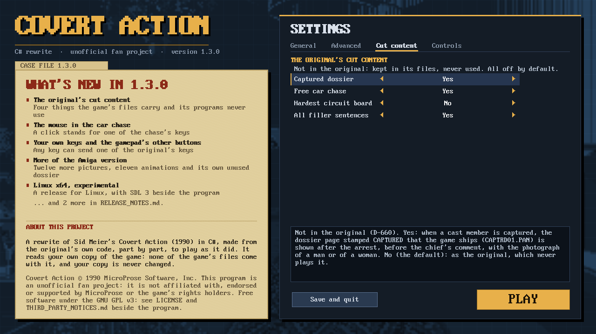
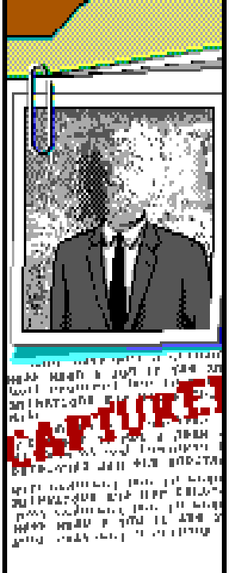
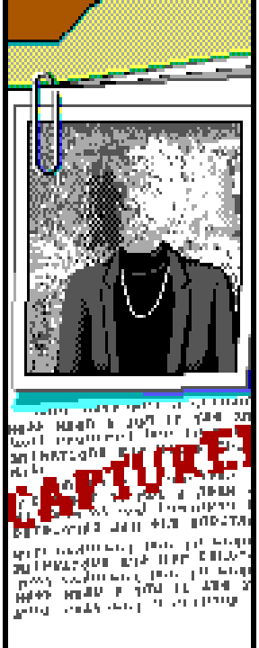
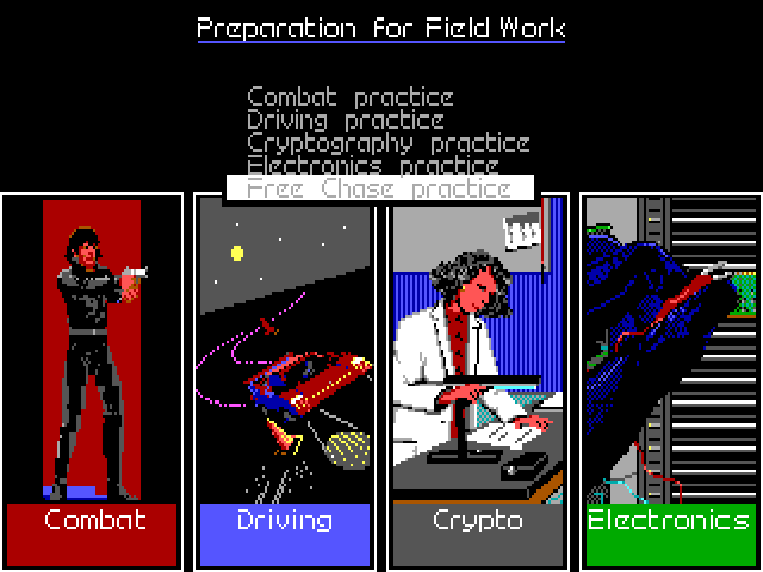
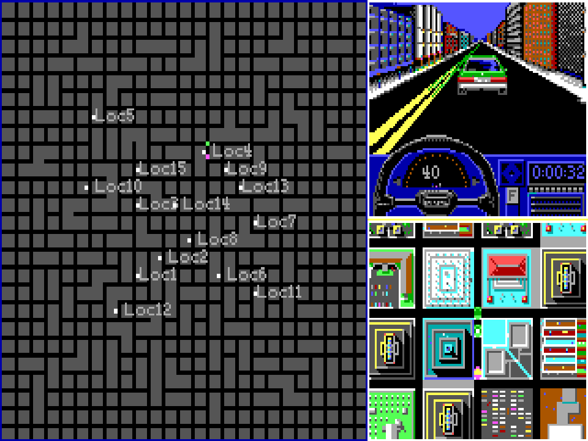
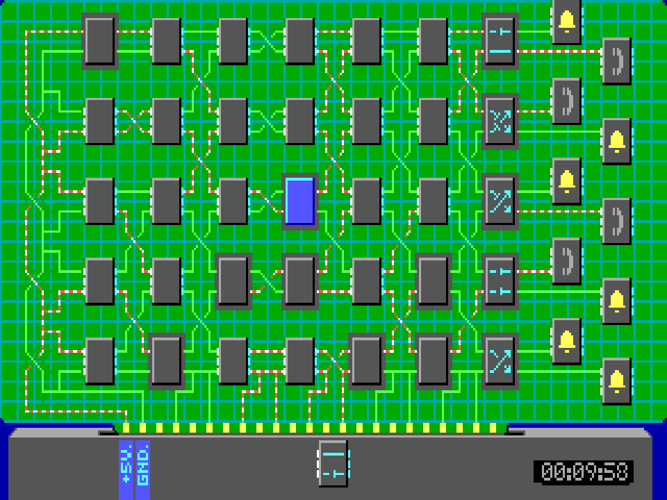

# The cut-content options

Version 1.3 has five options for things the original game's own files and programs carry and never use. They are on
the launcher's **Cut content** tab, they are off by default, and none of them is in the original. With all five off the
game plays as version 1.0 and the original. Nothing is drawn or written new, except one menu line (the name "Free
Chase"); the pictures, the code and the texts are the game's own. Where each came from is in
[the register of cut content](cut-content.md) (the entries CC-n) and, as changes to the original's behaviour, in
[DIVERGENCES.md](../csharp/docs/faithfulness/DIVERGENCES.md) (D-660 to D-664).

To turn one on, open the launcher (Shift held while the game starts, or `CovertAction Launcher.exe`), choose the
**Cut content** tab, set the row to **Yes** and press **Save and quit** or **Play**. The settings file keys are
`cutContent.capturedDossier`, `cutContent.standaloneChase`, `cutContent.hardestCircuit`, `cutContent.fillerTexts` and `cutContent.chaseGrounds`
([the settings](../csharp/docs/SETTINGS.md)).

All the game pictures below were made from the author's own copy of the game, as the README's are. The launcher picture
is drawn by `CovertAction.exe --launcher-screenshot <file.png> --launcher-screenshot-tab cut`.

## Captured dossier

Row: **Captured dossier**. Key: `cutContent.capturedDossier`. Register: CC-1, CC-19; divergence D-660.

**What the original left unused.** `CAPTRD01.PAN`, a finished animation of a dossier page with a paper clip, a
photograph, lines of text and, after a moment, a red "CAPTURED" stamp. It is on the game's disks and no program of the
game names it. When a cast member is captured, the original shows only text. The animation also holds a second
photograph, of a woman (image 6), that its own script never selects, because the script's first instruction sets the
"man or woman" variable to "man" before the test that would choose.

**Evidence.** No program or data file contains the file's name; the animation is a complete 96 x 200 scene in the
same naming scheme as `SURNDR01.PAN`. The woman's photograph is chosen by the same variable that `INTRGATE.PAN` uses
and works with. CC-1 and CC-19 have the details.

**What you see.** When a cast member is captured (a building raid that ends in an arrest, or the car chase's arrest),
the page plays at the right edge of the screen, in the frame of the neighbouring scenes, after the jail scene and
before the chief's comment, with the person's name in the box. The photograph is the man's or the woman's by the
person's own sex; for a woman the copy of the script held in memory has its first instruction changed, and the file is
not touched. A suspect who is not a member of the case's cast gets no page.

<table>
<tr>
<td></td>
<td></td>
</tr>
<tr>
<td align="center">A man</td>
<td align="center">A woman</td>
</tr>
</table>

**Limits.** The pictures show the strip the scene is drawn in (the right 96 of the 320 columns). The faces in both
photographs are grey smudges: that is how the file is drawn. The page is a new step in a captured agent's flow; nothing
shows it was planned for that place, so it is an option only. On the 256-colour driver the scene's colour tables for the
CGA have no effect.

## Free chase

Row: **Free car chase**. Key: `cutContent.standaloneChase`. Register: CC-2; divergence D-661.

**What the original left unused.** The car chase program can run without a campaign: a random map, the places labelled
`Loc1` to `Loc15`, a random start and goal, every place shown. One variable selects the mode, and the program stores a
constant in it right where the map is made, so the mode never runs.

**Evidence.** `campaign_mode` is set to 1 in the chase's `main` and written nowhere else; the labels, the random
seeding and the random goal are written out in full in the map generator for the other value (CC-2).

**What you see.** The practice menu (main menu, **Practice a skill**, a level) has a fifth line, **Free Chase
practice**. It starts the car chase with a new random map every time, 15 places dotted and labelled `Loc1` to `Loc15`,
and a random start and goal. F2 enters any place on the map as the building (the map shows them all, so all are
known). It is a practice: nothing is written to a campaign, and the chase returns to the menus as the driving practice
does.

<table>
<tr>
<td></td>
<td></td>
</tr>
<tr>
<td align="center">The practice menu</td>
<td align="center">The free chase: the map</td>
</tr>
</table>

**Limits.** The map is made from the clock, not from a city, so it is different at each start. The original's own test for
F2 in this mode would read the city's list of known places, which is empty in a practice; so the option takes every place
as known. The words "Free Chase" are the only new text. The second chase mode, code 5, is not offered (see below).

## Hardest circuit board

Row: **Hardest circuit board**. Key: `cutContent.hardestCircuit`. Register: CC-16; divergence D-662.

**What the original left unused.** The electronics workbench's board code has a difficulty 4: one test, in the part
that fixes the chip of the fifth column in place, applies only to it. The part's start routine works out the difficulty
as the level of play less the agent's electronics rating plus one, and cuts it down to 3, so 4 never occurs.

**Evidence.** The test `difficulty == 4` is in the original's board code and the clamp is in `bug_init` (CC-16).

**What you see.** The clamp is 4. Only the hardest level of play with an agent of the lowest electronics rating reaches
it (3 less 0, plus 1); every other level and rating gives what it gave. The board then shows only its last column of chips,
hides eight fixed chips, needs four phones cut off with no two neighbouring terminals live, and has 16 to 20 diagonals
in its wiring. It applies to the wiretap and to the car tracer, which use the same board code.

**Limits.** A practice gives every skill the rating 1, so the board cannot come from the practice menu; it comes in a
campaign, at the hardest level, with an agent whose electronics skill is the lowest. The picture was made by a test that
starts the electronics part at that level with that rating. Every board tried can be won (the search of CA-62 finds a win
on all of them). The intelligence a tap gathers is worked out from the level of play as before, so it is not changed.
A board harder than the game's hardest is an addition; the original's own hardest is 3.

## All filler sentences

Row: **All filler sentences**. Key: `cutContent.fillerTexts`. Register: CC-11; divergence D-663. No picture: it is text
in a coded message.

**What the original left unused.** `TEXT.DTA` holds sixteen filler sentences, `*FLUF00` to `*FLUF15`, for the paragraph
of a coded message that carries no information. The game asks for 12, so the last four are never shown.

**Evidence.** `compose_message_text` calls the reader with the count 12; the file has 16 entries (CC-11).

**What you see.** The count is 16, so the filler of an intercepted message can also be one of: "Extreme caution is
advised. Message security must be maintained.", "Do not hesitate to act in a decisive manner.", "Your request for
promotion is being considered." and "Further communications may follow."

**Limits.** The call and the place are the same; only the count differs. With 16 outcomes instead of 12 the random draw
takes a different number, and so the numbers the game draws after it differ.

## All 20 chase grounds

Row: **All 20 chase grounds**. Key: `cutContent.chaseGrounds`. Register: CC-25; divergence D-664. No picture is shown here.

**What the original left unused.** The car chase's ground pictures are 32 x 32 cells of `CHASE.PIC`, ten to a row. The
sheet has room for twenty; the map generator draws one of the first sixteen for each block of the city.

**Evidence.** `generate_map` draws `random_below(16)` per cell; the four last cells of the second row are drawn by nothing
(CC-25). Two of them are copies of earlier grounds (16 of 11, 18 of 10); 17 (a tall blue and purple striped block) and 19
(a green court with a white U-shaped plaza) are new art.

**What you see.** The draw is among twenty, so these four grounds appear in the city's blocks. The free car chase (the
**Free car chase** option) uses the same map generator and has them too.

**Limits.** The generator makes the same random calls in the same places; only the range of the ground's draw differs. So the
streets, the places and every later draw are the original's, and only the ground pictures of the blocks are not. The Amiga
pictures option changes only the chase's windscreen views, not CHASE.PIC, so the same four cells show with it.

## Left out, and why

Every entry of [the register](cut-content.md) was considered. These are not offered, each for a reason of its own.

* **CC-3, the arrest-only chase (module code 5).** Nothing starts it. The chase program makes the closing texts for
  losing and for being spotted only in the tail and flee modes, so this mode would end in an empty box except after an
  arrest. Nothing in the files says what the mode was for, and it would need text written for it.
* **CC-5, variants 3 to 6 and variant 7 of the plots.** Variants 3 to 6 have no crime file and no text in `PLOT.TXT`.
  Variant 7, "Max Remington's apartment", would run the tutorial's crime file under a plot, but the apartment page
  loop and the debriefing's closing text (`*PLppv7k`, `*PLpp7p`) have no text in the game's files: the case would begin
  and end without the words the other variants have. Writing them would be writing new game text.
* **The TAC corridor-walk flag of CC-16.** The flag would keep the building generator's walk going until it reached a room
  the player had visited. The walk builds a new building, where no room has been visited, so with the flag set it would
  run out of tries and the layout would be rejected every time.
* **CC-13, shadowed duplicate tags.** The reader takes the first match of a tag and no caller can skip to the second;
  the one exception, the bulletin of `*MSG0102`, is already reachable through the campaign-logic fix of version 1.2 (D-650).
  The other duplicates (`*C0102`, `*C0104`, `*PL0815`) are another crime's text pasted in under the tag; showing them
  would need a reader changed to a text it was never given.
* **CC-18, the prose variants `*nice3` to `*nice7`.** No cast member asks for them (ranks in the crime files run from 1 to 7,
  so the variant is 0, 1 or 2). Only a suspect who is no cast member does, through the original's reading past the
  cast (CA-33), and the texts do not exist.

The cut content not offered at all:

* **CC-4**, module code 0x63 (`mcv.exe`): the program it starts is not on the disks.
* **CC-6**, a seventh sound card and the flag that skips the sound question: menu code with a loop bound of six and a
  table with no data; there is nothing to show.
* **CC-7**, the custom sound driver: announced by the publisher for the future, never shipped; `XSOUND.CA` does not exist.
* **CC-8**, INTRO's unused graphics file-name table and the H/V letters: the drivers they name (Hercules, a separate
  VGA) are not on the disks.
* **CC-9**, the 56 sentences of the graphics library's design notes: comment text compiled into CODE, not a game feature.
* **CC-10**, 41 functions nothing calls: copies of shared library and campaign source in each program, not features.
* **CC-12**, message texts nothing asks for and events without a text: texts of events removed from scripts, or lost;
  there are no events to attach them to.
* **CC-14**, crime-file fields no module reads: data structure, not content a player could see.
* **CC-15**, mouse support in the graphics library: library code. The mouse of the Controls tab is a separate addition
  (D-630), not a restoration of it.
* **CC-17**, the other dormant statements: single statements and arms with no way to be reached; none is a feature.
* **CC-20**, the key-press exit sequences of four scenes: the game's side that would set them (`ignore_skip`) was never
  finished, and the sequences reuse images the scenes already show.
* **CC-21**, the animations' leftovers: nothing hidden; one unstarted blink of two images that are shown anyway.
* **CC-22**, face-sheet icons and the half sheet: no code draws them and nothing shows what they were for.
* **CC-23**, sound commands never sent or sent into silence: a difference between the sound drivers, and nothing shows what
  commands 15 and 21 were for.

## On the Amiga

The Amiga version was checked item by item against the PC's: its
program read from its code and symbol table, its data files compared byte for byte with the PC's. Nothing the PC leaves
unused is used on the Amiga, and the Amiga adds one unused scene of its own.

* **The dossier.** The Amiga ships its own unused dossier, `CAPT1FPO.PAN` (96 x 200; "FPO" may be the printer's
  "for position only", a placeholder), and no Amiga program names it either. It holds the PC dossier's pictures and
  two more photo frames. A capture on the Amiga, as on the PC, shows the jail scene and the chief's comment only. The
  Amiga's script was read (its `.pan` container is decoded, D-683: the PC's machine with wider fields) and it **has the
  woman's-photograph switch, and a working one**: it tests variable 0 (1: a woman, -1: a man, as the game sets it for the
  jail scene) and does not begin by setting the variable to -1 as the PC's `CAPTRD01.PAN` does (CC-19). The two extra
  frames are placeholder faces: image 5 an unnamed man in a grey cap, image 7 a smiling woman with green earrings, each
  drawn behind the torso (image 4 or 6) that the PC's dossier has without any face. With the dossier option and the Amiga
  pictures option (`graphics.amiga`) both on, the rewrite plays the Amiga's `CAPT1FPO.PAN` in place of the PC's page
  (D-684), so the page has a face (the Amiga's stand-in; the game draws no face of the captured person on either
  version) and shows the woman's photograph for a woman. With the dossier option alone it plays the PC's page as before.
* **The car chase on its own, the arrest-only chase, the circuit board's fourth difficulty and the raid's corridor
  walk**: the same dormant code as on the PC, switched off in the same places.
* **The plot variants**: the same table, with the same three variants filled, and the same unreachable apartment case
  with no text for it.
* **The texts**: the same tags in TEXT.DTA, PLOT.TXT, CLUES.TXT and PROSE.DTA, the same four unused filler sentences
  (the Amiga also draws from the first twelve), the same shadowed duplicates, and no `*nice3` to `*nice7`. The crime and
  world files are the PC's, stored in the Amiga's byte order.
* **One difference**: the PC's program has a dormant start code (CC-4, `mcv.exe`) that the Amiga's has not.

The Amiga corrects a few of the PC's typing errors and ships a filled Hall of Fame file; neither is cut content.
